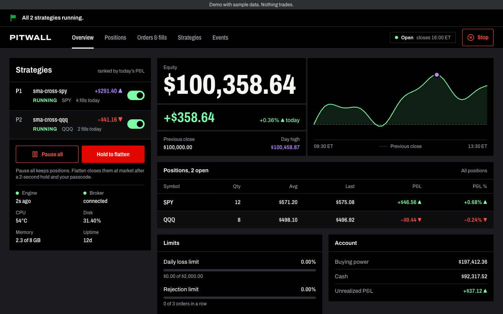
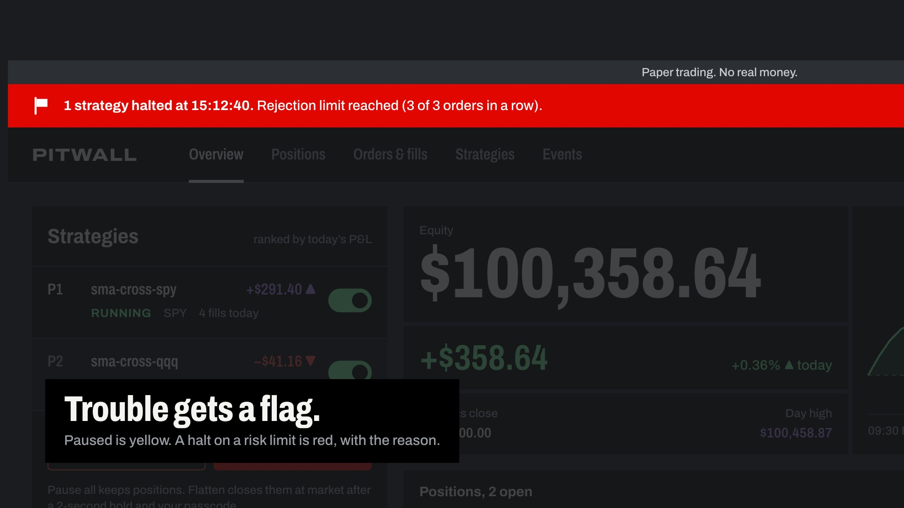
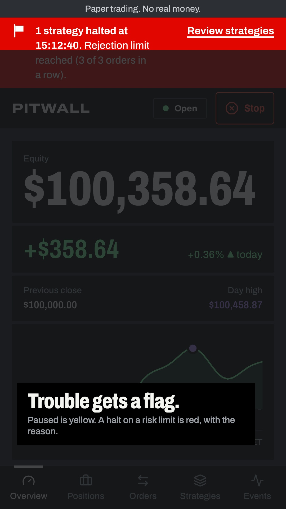

# Pitwall

Pitwall runs a small trading bot on a Raspberry Pi 5 and gives you a private dashboard to watch it and stop it. The bot trades US equities through Alpaca. The dashboard answers three questions at a glance: is the bot healthy, what does it hold, and how much is it up or down today. It also gives you Pause all, per-strategy pause and resume, and a passcode-guarded Flatten.

**Try the demo:** https://bjdealey.github.io/pitwall/ runs the real dashboard on sample data with a simulated engine in your browser. Pause, resume, Pause all and Flatten all work, and nothing trades: the demo never talks to a broker or a Pi.



**Launch video** (22 seconds, with sound), on desktop and on a phone. Select a poster to play it.

<p>
  <a href="docs/brag.mp4"></a>
  <a href="docs/brag-vertical.mp4"></a>
</p>

It is two processes that share one SQLite file:

- `src/engine` runs the strategies, talks to the broker, enforces the risk halts (daily loss, rejected orders in a row, broker silence) and the trading rules (entry window, stop, flat before the close, position sizing, daily trade cap), and writes everything to SQLite.
- `src/api` serves the built dashboard, one Server-Sent Events stream and the POST endpoints for sign-in and commands. It never writes engine data. Your commands go into a `commands` table that the engine applies on its next 5-second tick.

A dashboard crash never stops trading, and an engine crash shows up as a STALE dashboard and an ntfy alert.

> **Paper or live.** `PITWALL_LIVE=true` together with `PITWALL_BROKER=alpaca` sends real orders with real money to Alpaca's live endpoint. Every other combination uses paper trading or the local simulator. The dashboard shows PAPER or LIVE in the banner on every screen and cannot switch modes. Change the flag only on the Pi, on purpose, and restart both services.

## Develop

You need Node 24.7 or newer. TypeScript runs directly through Node's type stripping, so the engine and API have no build step.

```sh
npm install
cp .env.example .env
printf %s 'choose-a-passcode' | npm run -s hash-passcode >> .env   # appends PITWALL_PASSCODE_HASH='...'
echo "PITWALL_SESSION_SECRET=$(openssl rand -base64 48)" >> .env
npm run dev
```

The appended lines override the empty ones from the example. Keep the single quotes around the hash, because it contains `$` characters.

`npm run dev` starts the engine with the broker `.env` names in `PITWALL_BROKER`, the API on `127.0.0.1:8080` and Vite on `http://127.0.0.1:5173`, with prefixed output. With `PITWALL_BROKER=sim` the simulator gives every symbol a seeded random walk with a new bar every 5 seconds, an always-open market, $50,000 of cash and instant fills. It resets when the engine restarts. Its session never ends, so the entry window and flat-by stay out of the way. The daily trade cap still applies, so raise `PITWALL_MAX_TRADES_PER_DAY` for long sim runs.

Other scripts:

- `npm test` runs the `node:test` suites in `src/**/*.test.ts`.
- `npm run typecheck` checks the Node and the web configs.
- `npm run build` builds the dashboard into `dist/web`, which the API serves.
- `npm run build:demo` builds the GitHub Pages demo into `dist/demo`: the same dashboard on sample data, with no API. `.github/workflows/pages.yml` publishes it on every push to `main`.
- `npm run design-system` renders the components into the design system files in `dist/design-system`.
- `npm run tokens` regenerates `src/web/tokens.css` from `design/tokens.json`.
- `npm run db:generate` writes a new migration into `drizzle/` after you change `src/shared/schema.ts`. Both processes apply pending migrations at startup.
- `npm start` prints how to run the two production processes, `npm run start:engine` and `npm run start:api`.

The session cookie is `Secure`. Browsers accept it on `http://127.0.0.1` and `localhost` during development. Over Tailscale it rides on HTTPS.

## Run it on a Raspberry Pi

1. **Hardware.** Boot the Pi 5 from an SSD rather than an SD card, since SQLite writes every 5 seconds.
2. **Node.** Install Node 24 LTS, for example from NodeSource:
   ```sh
   curl -fsSL https://deb.nodesource.com/setup_24.x | sudo -E bash -
   sudo apt install -y nodejs sqlite3 rsync
   ```
   The units expect `/usr/bin/node`. Adjust `ExecStart` if yours lives elsewhere.
3. **User and code.** Create a `pitwall` user and clone the repo to `/home/pitwall/pitwall`. As that user, run `npm ci` and `npm run build`. `better-sqlite3` ships a prebuilt linux-arm64 binary, so no compiler is needed.
4. **Tailscale.** Install Tailscale and join your tailnet. Then publish the API over HTTPS on the Pi's `*.ts.net` name:
   ```sh
   sudo tailscale serve --bg 8080
   ```
   The API binds to `127.0.0.1` only, so Tailscale is the one way in. Open no router ports.
5. **Environment.** Copy `.env.example` to `/home/pitwall/pitwall/.env` and fill it in. Set `PITWALL_BROKER=alpaca` with your Alpaca paper keys, generate the passcode hash with `npm run -s hash-passcode`, and generate a session secret with `openssl rand -base64 48`. Set `NTFY_URL` to get halt, error and engine-down alerts on your phone. Then run `chmod 600 .env`.
6. **Services.**
   ```sh
   sudo cp deploy/pitwall-*.service deploy/pitwall-backup.timer /etc/systemd/system/
   sudo systemctl daemon-reload
   sudo systemctl enable --now pitwall-engine pitwall-api pitwall-backup.timer
   journalctl -u pitwall-engine -u pitwall-api -f
   ```
   Both services restart on failure. The engine finishes its current tick on SIGTERM, so `systemctl restart pitwall-engine` never interrupts a tick halfway.
7. **Backups.** `pitwall-backup.timer` runs `sqlite3 .backup` every night at 03:30 into `data/backups/`, keeps 14 days there, and then runs `rsync` to `PITWALL_BACKUP_TARGET`. Point that at your Mac or NAS over Tailscale, for example `mac-mini:pitwall-backups/`, and give the `pitwall` user an SSH key that the target accepts. Run it once by hand with `sudo systemctl start pitwall-backup` and check `systemctl status pitwall-backup`.

To update, run `git pull && npm ci && npm run build`, then `sudo systemctl restart pitwall-engine pitwall-api`. A paused or halted strategy stays paused or halted across restarts. Resume is always a deliberate action in the dashboard.

## Signing in

The passcode is stored only as an argon2id hash. A successful sign-in sets a 30-day HttpOnly cookie on that device. Five wrong passcodes, counted across sign-in and Flatten, lock both for 15 minutes. The count lives in the API process, so restarting the API clears it. Flatten always asks for the passcode again.
